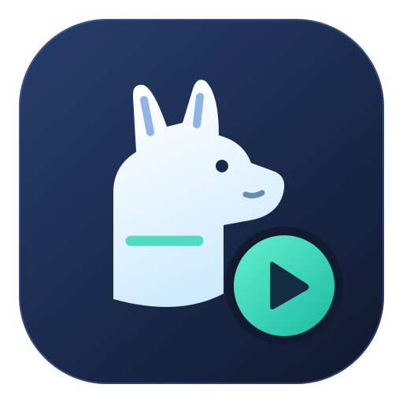
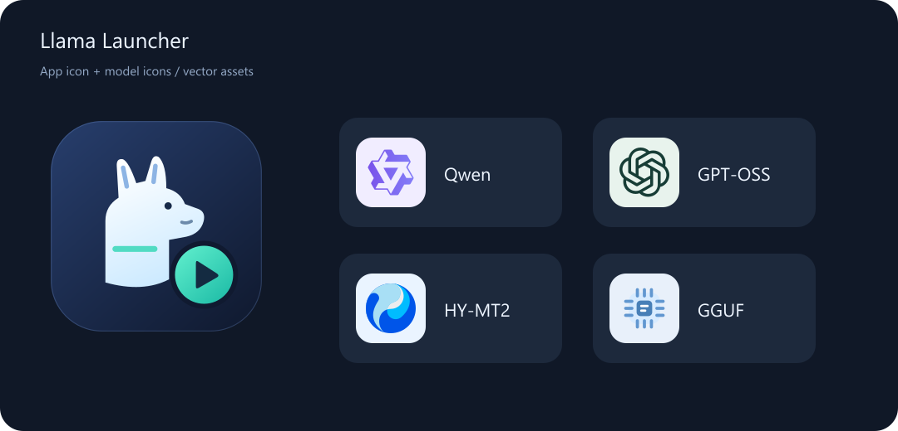

<p align="center"></p>

# Llama Launcher · WinUI 3

**A Windows 11 desktop launcher for local GGUF models and llama-server.**

[简体中文](README.md) · [Client setup](docs/CLIENTS.en.md) · [1.3.0 release notes](RELEASE_NOTES.md) · [Windows x64 downloads](https://github.com/accbilili/llama-launcher-winui3/releases)

Select a model, configure launch parameters, start your local `llama-server`, and connect WorkBuddy, Cherry Studio, or DeepSeek Harness. The launcher is built with C# and WinUI 3; inference runs in a separately installed llama.cpp server.

> **Version 1.3.0 is a preview.** The application UI is currently in Simplified Chinese; documentation is available in Chinese and English. Compilation and offline checks have passed. The new window interactions, GPU monitoring recovery, and real conversations in the three clients still need runtime testing.

## Features

| Feature | Details |
| --- | --- |
| Local model browser | Recursively scans GGUF files and reads architecture, declared quantization, training context, and model name; lists the first shard of split models |
| Launch settings | Port, context, GPU layers, CPU threads, batch size, Flash Attention, KV cache, and sampling parameters |
| Per-model presets | Multiple named presets, with a clear distinction between saved settings and the running server's settings |
| Thinking settings | Exposes `enable_thinking` or `reasoning_effort` when declared by the model's chat template |
| Server management | Start, stop, restart, port checks, health status, and logs; manages server processes started by this launcher |
| Client setup | WorkBuddy configuration and backup restoration, Cherry Studio provider import, and Harness setup information/YAML snippets |
| Diagnostics | Basic completion, streaming, and tool-call round-trip checks; text and translation tests |
| Desktop features | Windows dedicated GPU memory monitoring, manual re-detection, system tray, existing-window activation, and saved window placement |
| High DPI and icons | PerMonitorV2, responsive window layouts, multi-size application ICO, and SVG model icons |

## Icon preview



This image shows the icons, not a screenshot of the 1.3.0 UI. Qwen, GPT-OSS, and HY-MT2 have family identifiers; other models use a generic GGUF icon.

## Requirements

- **Windows 11 x64.** Windows 10, ARM64, Linux, and macOS builds are not provided.
- A working [`llama-server.exe`](https://github.com/ggml-org/llama.cpp/tree/master/tools/server) installation, including its required runtime files.
- Locally available GGUF models that you are entitled to use, with enough RAM or VRAM.
- The relevant third-party application if you want to connect a client.

The release includes .NET and WinUI runtimes and does not require Python. Models, llama.cpp, and third-party clients are not bundled. GPU acceleration depends on your llama.cpp build, drivers, and hardware.

## Quick start

1. Download `LlamaLauncher-WinUI3-1.3.0-win-x64.zip` from Releases and extract the entire archive to a writable folder. Keep the runtime and resource files alongside the EXE.
2. Exit any older launcher version, then run `LlamaLauncher.exe`.
3. In **路径设置** (Paths), select `llama-server.exe` and your model folder. The default model folder is `D:\AI\models`; you can change it.
4. Select a model, set context and GPU layers, click **启动模型** (Start model), and wait for **服务已就绪** (Server ready).
5. Use **打开聊天** (Open chat) for the server's web UI, or open **客户端接入** (Client setup) for connection details.

The server binds to `127.0.0.1`. For port `8081`:

| Purpose | Address |
| --- | --- |
| Browser chat | `http://127.0.0.1:8081/` |
| OpenAI-style API base | `http://127.0.0.1:8081/v1` |
| Full Chat Completions endpoint | `http://127.0.0.1:8081/v1/chat/completions` |
| Model list | `http://127.0.0.1:8081/v1/models` |

The model ID is the GGUF filename without `.gguf`; use the value displayed by the launcher. The launched server currently has no API key authentication. Use `local` as a placeholder when a client requires a nonempty key.

## Client integration

| Client | What the launcher provides | What you still do |
| --- | --- | --- |
| WorkBuddy | Preview and merge local model configuration, back up before writing, restore a selected backup | Enable custom protocol, use the full Chat Completions endpoint, and reselect the model |
| Cherry Studio | Import an OpenAI-type provider through the native link | Confirm import, fetch/add the model, then select it in chat |
| DeepSeek Harness | Copy setup information or export a YAML snippet | Add the provider/model in native settings; YAML is not merged automatically |

See [Client setup](docs/CLIENTS.en.md) for instructions and 404 troubleshooting. Generated settings and successful connection checks do not establish support for every Agent feature in these clients.

## Diagnostics and limits

**检查连接** (Check connection) reads only health and model-list endpoints. The basic, streaming, and tool-call checks make inference requests only when clicked. The tool check uses an in-memory echo function and does not run system commands. Checks support cancellation and a three-minute total timeout.

- Tool calling, reasoning output, and vision depend on the model, chat template, projector, and llama-server. UI capability indicators are not guarantees.
- GPU memory readings represent dedicated memory usage across the whole adapter. Readings may be unavailable when the driver does not expose counters.
- PerMonitorV2 and responsive layouts are implemented; cross-monitor, 4K scaling, and placement restoration in 1.3.0 still need runtime validation.
- Hiding to the tray keeps the server running. Exiting stops the server started by this launcher. Closing exits by default; close-to-tray is optional.
- Model downloading, automatic updates, full chat-history management, and simultaneous multi-model serving are not included.

## Build from source

On Windows 11 x64, install the **.NET 10 SDK** and run from the repository root:

```powershell
.\build.ps1
```

The output is `release-1.3.0\LlamaLauncher.exe`. The first build restores NuGet packages. The project uses Windows SDK 10.0.26100-series tools and WinUI 3, with package versions pinned in the project file. Generated icon assets are included; a normal build does not need Node.js.

Offline check entry point:

```powershell
dotnet run --project checks\StaticChecks.csproj -c Release
```

This entry point reads local settings and GGUF files, so valid model and llama-server paths must be configured first. HTTP checks use an in-memory handler; WorkBuddy write checks use temporary files. It does not start a model or change real client settings. `tests\SmokeTests.csproj` is an earlier real-model test with a three-model environment assumption; it starts servers and sends requests and is not a generic offline test.

Current verification: Release build with zero warnings/errors; backup restoration, simulated API success/failure cases, GGUF metadata, and argument checks passed. These results are not real-client end-to-end validation.

## Local data

Settings and presets: `%LOCALAPPDATA%\LlamaLauncherWinUI\settings.json`. Server logs: `logs\server-*.log` under the same data folder. Client exceptions: `client-errors.log`.

WorkBuddy configuration is stored in `%USERPROFILE%\.workbuddy\models.json`, with backups in that directory. Changes occur only after an explicit write or restore action. The launcher does not edit model files.

## Credits and third-party notices

- UI and workflow inspiration: [lop008/llama-gui-launcher](https://github.com/lop008/llama-gui-launcher). This project uses C# and WinUI 3.
- Inference server: [llama.cpp](https://github.com/ggml-org/llama.cpp).
- Model icons: [LobeHub Icons](https://github.com/lobehub/lobe-icons). See [asset notes](src/Assets/README.md) and the included [MIT license](licenses/LobeHub-Icons-MIT.txt).
- Other bundled component licenses/notices are retained in `licenses/`. Model and client names/logos belong to their respective owners and do not imply endorsement or affiliation.

The repository owner's choice of license for this project's own code is pending. Third-party licenses do not automatically license the entire project under the same terms.
